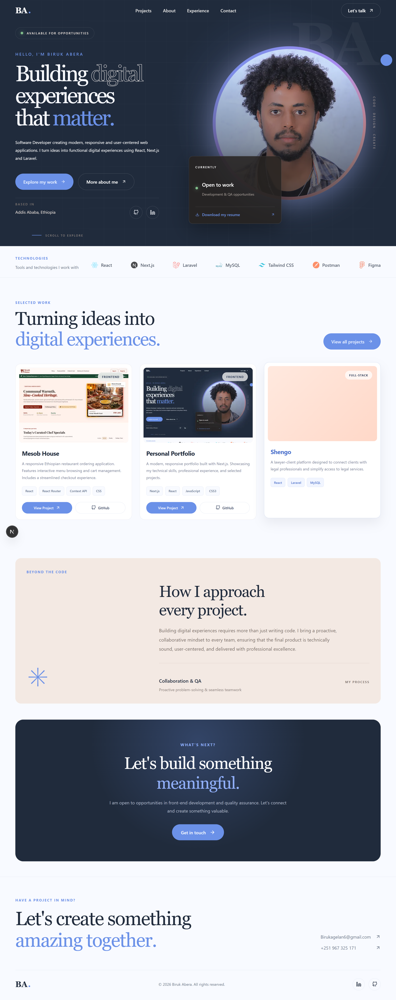
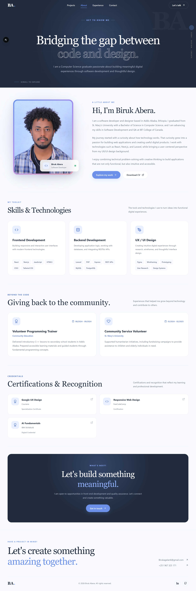
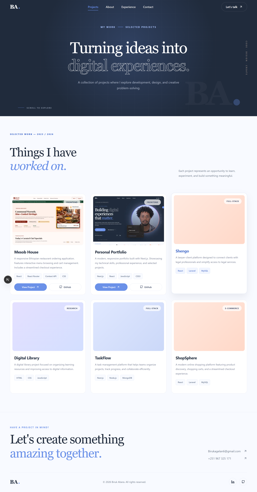
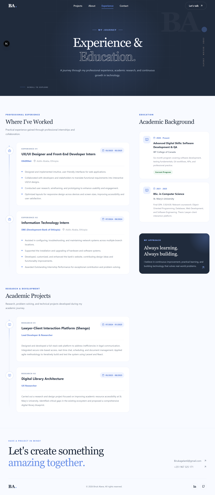
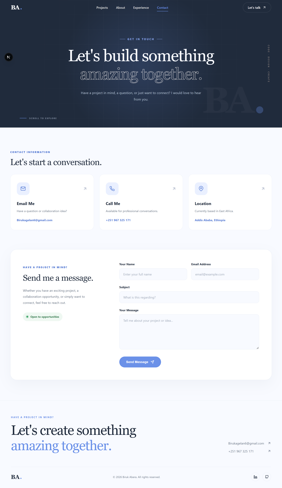

# Biruk Abera | Personal Portfolio

A modern, responsive personal portfolio website built with Next.js to present my professional background, technical skills, experience, and selected work. Designed with a focus on clean user interfaces, responsive layouts, accessibility, and a consistent user experience across different devices.

## Live Demo

**[Visit My Portfolio](biruk-abera-portfolio-gules.vercel.app)**

## Features

- **Modern User Interface:** Clean layouts, consistent typography, and a visually engaging design.
- **Responsive Design:** Optimized layouts for desktop, laptop, tablet, and mobile devices.
- **Home Page:** Professional introduction, profile presentation, and featured projects.
- **About Page:** Personal background, technical skills, and professional interests.
- **Projects Page:** Dedicated presentation of selected projects with descriptions, technologies, live demonstrations, and source code links.
- **Experience Page:** Professional experience and educational background.
- **Contact Page:** Contact information and communication options.
- **Resume Download:** Direct access to my professional CV.
- **Reusable Components:** Modular and maintainable React components.
- **Consistent Navigation:** Easy navigation between portfolio sections.

## Technology Stack

### Frontend

- **[Next.js](https://nextjs.org/)** – React framework used to build the website with the App Router.
- **JavaScript (ES6+)** – Used for application functionality and logic.
- **CSS3 (Vanilla CSS)** – Used for custom styling, layouts, animations, and responsive design.

## Project Structure

```text
biruk-abera-portfolio/
│
├── public/
│   ├── projects/
│   ├── screenshots/
│   │   ├── home.png
│   │   ├── about.png
│   │   ├── projects.png
│   │   ├── experience.png
│   │   └── contact.png
│   └── cv/
│
├── src/
│   ├── app/
│   │   ├── about/
│   │   ├── contact/
│   │   ├── experience/
│   │   ├── projects/
│   │   ├── api/
│   │   │   └── contact/
│   │   ├── globals.css
│   │   ├── Homepage.css
│   │   ├── layout.js
│   │   ├── not-found.css
│   │   ├── notfound.js
│   │   └── page.js
│   │
│   ├── components/
│   └── data/
│
├── .gitignore
├── next.config.mjs
├── package.json
├── package-lock.json
└── README.md
```

## Getting Started

Follow these instructions to run the project locally.

### Prerequisites

- [Node.js](https://nodejs.org/)
- npm
- Git

### Installation

**1. Clone the repository**

```bash
git https://github.com/Biruk-ete/biruk-abera-portfolio
```

**2. Navigate to the project directory**

```bash
cd biruk-abera-portfolio
```

**3. Install dependencies**

```bash
npm install
```

**4. Configure environment variables**

If the application requires environment variables, create a `.env.local` file in the root directory and add the required configuration.

Do not commit private credentials or environment files to GitHub.

**5. Run the development server**

```bash
npm run dev
```

**6. Open in your browser**

```text
http://localhost:3000
```

## Deployment

The application can be deployed using [Vercel](https://vercel.com/).

1. Push the project to a GitHub repository.
2. Import the repository into Vercel.
3. Configure the required environment variables.
4. Deploy the application.

## Screenshots

### Home Page



### About Page



### Projects Page



### Experience Page



### Contact Page



## Contact

**Biruk Abera**

Software Developer

- **Email:** birukabelan6@gmail.com
- **GitHub:** [@Biruk-ete](https://github.com/Biruk-ete)
- **LinkedIn:** [Biruk Abera](https://www.linkedin.com/in/birukabera/)

---

Designed and developed by **Biruk Abera**.
